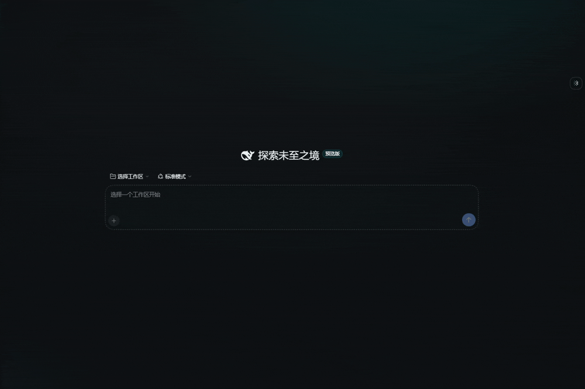
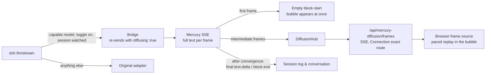

<div align="center">

# dsh-mercury-diffusion

**Watch a diffusion LLM think — live, inside your DeepSeek Harness chat.**

A [DeepSeek Harness](https://github.com/deepseek-ai/deepseek-harness) (dsh) plugin that streams the real denoising frames of [Inception Mercury](https://docs.inceptionlabs.ai) and plays them in the answer bubble, from noise to finished text.

[](https://www.npmjs.com/package/dsh-mercury-diffusion)
[](LICENSE)
[](https://github.com/deepseek-ai/deepseek-harness)
[](package.json)

English · [简体中文](README.zh-CN.md)



</div>

---

## Highlights

- 🌀 **Real frames, not a fake animation.** Every frame is a denoising state returned by the Mercury API (`diffusing: true`), replayed at a readable pace.
- 🔌 **Works with the provider route you already have.** The plugin registers no provider and no settings page of its own; it adds a diffusion layer under the route you add on dsh's Models page.
- 🧪 **Zero-cost capability probe.** Whether a route/model honors `diffusing` is measured with a request that is rejected before any token is generated. No model-name guessing, no billed tokens.
- 🛟 **Never breaks a conversation.** Attachments, auxiliary calls, unwatched sessions, routes without a credential, or a gateway that rejects the field all fall back to the original adapter untouched.
- 🧾 **Clean session logs.** Intermediate frames travel on a side channel; only the converged text is written to the log and shown to the model.
- 🎛️ **One-click toggle per model.** A small floating button appears for capable models; your choice is stored in dsh user settings (plugin config key `diffusion.<provider>::<model>`) and survives restarts.

## Quick start

**Requirements:** dsh `>=0.2.1-rc.2 <0.3.0`, Node `^22.19 || >=24`, and [`pnpm`](https://pnpm.io) on your `PATH` (`dsh plugin` uses it to manage profile plugins).

### 1. Install

```sh
dsh plugin --profile web add dsh-mercury-diffusion
dsh web
```

<details>
<summary>Install from source instead</summary>

```sh
git clone https://github.com/TonyWu2333/dsh-mercury-diffusion.git
cd dsh-mercury-diffusion
npm install
npm pack
dsh plugin --profile web add ./dsh-mercury-diffusion-0.2.1.tgz
dsh web
```

</details>

### 2. Add an Inception route

Open **Settings → Models → Add model provider → Custom model API** and fill in:

| Field | Value |
|---|---|
| Provider ID | `inception` |
| Display name | `Inception` |
| Base URL | `https://api.inceptionlabs.ai/v1` (must include `/v1`) |
| API protocol | OpenAI Chat Completions |
| API key | your Inception API key |
| Models | **Add model** → `mercury-3` (or `mercury-2.5`, `mercury-2`) |

Then click **Create provider**.

> [!WARNING]
> Don't point the built-in **DeepSeek** card at Inception. That adapter speaks a different protocol, and requests fail with `404`.

<details>
<summary>Prefer config files? Add the route to <code>cordis.patch.yml</code></summary>

```yaml
# ~/.dsh/profiles/web/cordis.patch.yml
- id: llm-pi-ai
  name: "@deepseek-ai/dsh-llm-pi-ai"
  config:
    providers:
      inception:
        displayName: Inception
        api: openai-completions
        baseURL: https://api.inceptionlabs.ai/v1
        apiKeyEnv: INCEPTION_API_KEY   # a credential reference, not the key itself
        models:
          - id: mercury-3
            name: Mercury 3
            contextWindow: 1000000
            maxTokens: 131072
```

Use the bare model id (`mercury-3`) when calling Inception directly. Gateways that aggregate providers usually expect the prefixed form (`inception/mercury-3`).

</details>

### 3. Turn it on

Pick the Mercury model from the model selector next to the send button and start a new conversation. A floating button appears on the right edge; switch diffusion **on** and send a message.

## How it works



<details>
<summary><b>Design notes</b></summary>

- **Frames never enter the session log or the model's context.** dsh's `StreamChunk` protocol only appends `text-delta`, while a diffusion frame replaces the whole text. Frames therefore travel on a side channel, and only the converged text is persisted as a normal assistant message, which keeps dsh's "model-visible ⟺ logged" invariant.
- **`diffusing` is requested only while a browser is watching.** The floating button component also holds the frame subscription, which is the "someone is watching" signal. Title generation, compaction, and headless/ACP runs always use plain incremental streaming.
- **Capability is probed, not inferred.** On entering a conversation, the plugin sends `messages: []` with `diffusing` set to an invalid type. Validation rejects it with `400` before generation; only a server that knows the field also reports a type error at `loc: ["body","diffusing"]`. The verdict (`yes` / `no` / `unknown`) is cached per `provider::model` in the process; `unknown` is kept for 60 seconds only.
- **Only faithful re-sends are bridged.** Images or files, auxiliary calls, unwatched sessions, and disabled models go to the original adapter. If the gateway rejects `diffusing` before the first frame, the request falls back too. A user abort ends the turn instead of re-sending on an aborted signal.
- **Only the diffusion flag is added.** Gateway reasoning-effort vocabularies (`max` / `xhigh`) and temperature ranges differ from Inception's, so the bridge drops `reasoningEffort` and `temperature` and adds `diffusing: true`. `max_completion_tokens`, `stop`, and tools are forwarded.
- **Paced playback.** A Mercury answer usually has only 5–10 frames, often arriving together, so the browser shows each frame for at least 180 ms and holds the converged text for 400 ms before swapping in Markdown.
- **Bubble claiming.** One diffusion attempt binds to exactly one bubble: the one being generated, or the one whose text equals the final frame. In multi-step turns a later bubble never steals an earlier one's animation.
- **Owner-only frame channel.** The frames route is open to the owner peer only and follows dsh Connection authentication.

</details>

<details>
<summary><b>About the replaced assistant renderer</b></summary>

dsh exposes no extension point for the body of assistant messages, and keyed slots can only be replaced, not wrapped. The plugin therefore registers `conversation.chat.node[assistant-step]` at a higher priority, so **assistant messages from every model render through it**. The normal path is ported from dsh ui-chat's `AssistantNodeView` (MIT, see [THIRD_PARTY_NOTICES.md](THIRD_PARTY_NOTICES.md)).

- **Kept as-is:** Markdown and code blocks (`MarkdownText`), file links, step folding, and the official reasoning-body and image-gallery factories.
- **Difference from native:** the "preview after completion" setting for reasoning belongs to ui-chat's own registration and isn't visible to the plugin, so the preview shows only while generating.
- **Fully reversible:** disabling or uninstalling the plugin restores dsh's native renderer immediately.
- **Upgrade risk:** if a dsh release changes the assistant message shape, this renderer must be updated with it.

</details>

## Upgrading from 0.1.x

0.1.x registered its own `mercury` provider, with the API key read from `INCEPTION_API_KEY` or set on the plugin's settings page. Both are gone in 0.2: add the Inception route as shown above and point your default model at it. Conversations pinned to the old `mercury` provider need a model re-selection.

A route that names no credential reference (no `apiKeyEnv` in its profile and no auth variable declared by its adapter) is never bridged, so the plugin never sends one provider's key to another provider's host. Keys entered on the Models page are stored as references automatically.

## Troubleshooting

| Symptom | Likely cause |
|---|---|
| `DeepSeek Messages request failed (404)` | The Inception URL was entered on the built-in DeepSeek card. Add a **Custom model API** route instead. |
| The floating button never appears | The route has no credential, or the probe returned `unknown`. Check `detail` in the status payload (see below). |
| No animation, plain streaming | Diffusion is off for this model, the turn has attachments, or no browser tab is watching the session. |

To log frame receipt and bubble claiming, run this in the browser console and reload:

```js
localStorage.setItem('dsh-mercury-debug', '1')
```

The last status payload is kept in `localStorage['dsh-mercury-last-status']`. Its `detail` field names the step that decided the verdict (`measured`, `no-route`, `no-credential`, or `no-selection`).

## Known limitations

- Inception documents diffusion frames for **text** only. Whether tool-call arguments arrive as deltas or full snapshots in diffusion mode is undocumented; the bridge keeps both forms and picks the one that parses as JSON at the end. This has not been verified against the real API.
- Playback uses real frames, so the frame count is up to the model: typically 5–10 frames, about 1–2 seconds of animation. Inception's website uses a fixed 1.5-second front-end animation.
- There are no browser-side settings: dsh browser plugins can't read `cordis.yml`, so playback pacing and reconnect backoff are constants in code.
- Inception's free tier may be rate-limited at peak times ("free tier is at capacity"); dsh retries automatically and playback resumes on success.
- Mercury accepts text input only. dsh turns images into text placeholders, and turns with images or files are not bridged.
- Bridged requests don't forward `reasoningEffort` or `temperature` (see design notes).

## Development

```sh
git clone https://github.com/TonyWu2333/dsh-mercury-diffusion.git
cd dsh-mercury-diffusion
npm install
npm run typecheck
npm test          # node --test, including assembly checks against dsh's real BlockAssembler and end-to-end frame-channel tests
npm run build     # lib/index.js (host, ESM) + lib/client.js (dsh client-module closure format)
```

The build enforces bundle purity: the client bundle may only `require` modules from dsh's `PLATFORM_MODULES` and must not inline any `@deepseek-ai/*` runtime code.

`scripts/mock-mercury.mjs` is a local stand-in for the Mercury endpoint (`http://127.0.0.1:18931/v1`; tune with `MOCK_PORT`, `MOCK_STEPS`, `MOCK_STEP_MS`). It returns step-by-step denoised text for `diffusing` requests and plain deltas otherwise. To connect it, add a route on **Settings → Models → Add model provider → Custom model API**, no config file needed:

| Field | Value |
|---|---|
| Base URL | `http://127.0.0.1:18931/v1` |
| API protocol | OpenAI Chat Completions |
| Models | `mercury-3` |
| API key | anything; the mock doesn't check it |

> [!NOTE]
> Since 0.2 the plugin decides capability with a probe that the mock doesn't answer the way Inception does, so the toggle stays hidden against it. Use a real Inception key to try the full diffusion flow.

## Acknowledgements

- [Inception](https://www.inceptionlabs.ai) for Mercury and its `diffusing` streaming mode.
- [DeepSeek Harness](https://github.com/deepseek-ai/deepseek-harness), whose ui-chat assistant renderer the bubble rendering is ported from.

## License

[MIT](LICENSE)
