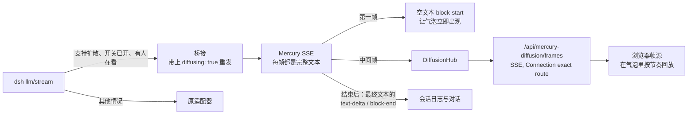

<div align="center">

# dsh-mercury-diffusion

**在 DeepSeek Harness 对话里，实时看扩散语言模型"想"出答案。**

一个 [DeepSeek Harness](https://github.com/deepseek-ai/deepseek-harness)（dsh）插件：获取 [Inception Mercury](https://docs.inceptionlabs.ai) API 返回的真实去噪帧，在回答气泡里原地播放从乱码收敛成答案的过程。

[](https://www.npmjs.com/package/dsh-mercury-diffusion)
[](LICENSE)
[](https://github.com/deepseek-ai/deepseek-harness)
[](package.json)

[English](README.md) · 简体中文


</div>

---

## 亮点

- **真实帧，不是假动画。** 每一帧都是 Mercury API（`diffusing: true`）返回的去噪状态，按可读的节奏回放。
- **直接用你已有的 provider 路由。** 插件不注册任何 provider，也不提供自己的配置页，只在你于 dsh 模型设置页里添加的路由下面加一层扩散渲染。
- **零成本能力探测。** 某个路由和模型是否支持 `diffusing`，用一条在生成之前就会被拒的请求来判断。不按模型名猜，也不花 token。
- **绝不弄坏对话。** 带附件、辅助调用、没人查看的会话、没有凭证的路由、不认这个字段的网关，一律原样交还原适配器。
- **会话日志干净。** 中间帧走旁路通道，只有收敛后的文本写入日志、发给模型。
- **每个模型一键开关。** 支持扩散的模型会出现一个悬浮按钮；你的选择存进 dsh 用户设置（插件配置的 `diffusion.<provider>::<model>`），重启后保持。

## 快速开始

**环境要求：** dsh `>=0.2.1-rc.2 <0.3.0`、Node `^22.19 || >=24`，以及 `PATH` 里可用的 [`pnpm`](https://pnpm.io)（`dsh plugin` 用它管理 profile 插件）。

### 1. 安装

```sh
dsh plugin --profile web add dsh-mercury-diffusion
dsh web
```

<details>
<summary>改为从源码安装</summary>

```sh
git clone https://github.com/TonyWu2333/dsh-mercury-diffusion.git
cd dsh-mercury-diffusion
npm install
npm pack
dsh plugin --profile web add ./dsh-mercury-diffusion-0.2.1.tgz
dsh web
```

</details>

### 2. 添加 Inception 路由

打开 **设置 → 模型 → 添加模型供应商 → 自定义模型API**，填写：

| 字段 | 值 |
|---|---|
| Provider ID | `inception` |
| Display name | `Inception` |
| Base URL | `https://api.inceptionlabs.ai/v1`（要带 `/v1`） |
| API protocol | OpenAI Chat Completions |
| API key | 你的 Inception API Key |
| Models | 点 **Add model**，填 `mercury-3`（或 `mercury-2.5`、`mercury-2`） |

然后点 **Create provider**。

> [!WARNING]
> 不要把内置的 **DeepSeek** 卡片改成 Inception 的地址。那个适配器用的是另一套协议，请求会报 `404`。

<details>
<summary>喜欢改配置文件？把路由写进 <code>cordis.patch.yml</code></summary>

```yaml
# ~/.dsh/profiles/web/cordis.patch.yml
- id: llm-pi-ai
  name: "@deepseek-ai/dsh-llm-pi-ai"
  config:
    providers:
      inception:
        displayName: Inception
        api: openai-completions
        baseURL: https://api.inceptionlabs.ai/v1
        apiKeyEnv: INCEPTION_API_KEY   # 凭证引用，不是 key 本身
        models:
          - id: mercury-3
            name: Mercury 3
            contextWindow: 1000000
            maxTokens: 131072
```

直连 Inception 时用不带前缀的模型 ID（`mercury-3`）。聚合多家 provider 的网关一般要带前缀（`inception/mercury-3`）。

</details>

### 3. 打开扩散渲染

在发送按钮旁的模型选择器里选 Mercury 模型，开一个新对话。右侧会出现一个悬浮按钮，把扩散渲染**打开**，然后发消息即可。

## 工作方式



<details>
<summary><b>设计要点</b></summary>

- **中间帧不进入会话日志，也不会发给模型。** dsh 的 `StreamChunk` 协议里 `text-delta` 只能追加，而扩散帧是整段替换，所以帧走旁路通道，只有收敛后的文本作为正常 assistant 消息落盘。这遵守 dsh "模型可见 ⟺ 写入日志"的约束。
- **只有当某个浏览器正在查看该会话时才请求 `diffusing`。** 悬浮按钮组件同时保持帧通道订阅，作为"有人在看"的信号。标题生成、上下文压缩等辅助请求，以及 headless / ACP 等没有 Web 的场景，一律使用普通增量流式。
- **扩散能力由探针判定，不看模型名。** 进入会话时发一条 `messages: []`、并把 `diffusing` 传成非法类型的请求。校验发生在生成之前，所以一定在产出 token 之前被 400；只有认识这个字段的服务端才会额外报一条 `loc: ["body","diffusing"]` 类型错误。结论（`yes` / `no` / `unknown`）按 `provider::model` 缓存在进程内，`unknown` 只缓存 60 秒。
- **只接管能忠实重发的请求。** 带图片或文件、辅助调用、没有浏览器查看的会话、该模型开关关闭，一律交还原适配器；网关若在第一帧之前拒绝 `diffusing`，也会退回原适配器；用户主动中止时直接结束，不会用已中止的信号再发一次。
- **只加扩散标志，不转发采样参数。** 网关的 reasoning effort 词汇（`max` / `xhigh`）和 temperature 范围都和 Inception 不同，所以重发时丢掉 `reasoningEffort` 和 `temperature`，只加上 `diffusing: true`；`max_completion_tokens`、`stop`、tools 照常转发。
- **按节奏回放。** Mercury 一次回答通常只有 5 到 10 帧，而且往往同时到达，所以浏览器端每帧至少显示 180 毫秒，收敛后停留 400 毫秒再换成 Markdown。
- **气泡认领。** 一次扩散只绑定到一个气泡：要么是正在生成的气泡，要么是正文与最终帧完全相同的气泡。多步回合里，后一步的气泡不会抢走前一步还在播放的动画。
- **帧通道只对 owner 开放。** 鉴权沿用 dsh Connection 的规则。

</details>

<details>
<summary><b>关于被替换的助手消息渲染器</b></summary>

dsh 没有给助手消息的正文开放扩展点，而 keyed 插槽只能整体替换、不能包一层。所以插件以更高优先级注册了 `conversation.chat.node[assistant-step]`，**所有模型的助手消息都会经过它**。正常情况下的渲染移植自 dsh ui-chat 的 `AssistantNodeView`（MIT 许可，见 [THIRD_PARTY_NOTICES.md](THIRD_PARTY_NOTICES.md)）。

- **完全沿用：** Markdown 和代码块（`MarkdownText`）、文件链接、过程折叠，以及官方的思考过程正文和图片画廊 Factory。
- **与原生的差异：** 思考过程的"完成后预览"开关读的是 ui-chat 自己注册时拿到的设置，插件拿不到，所以只在生成过程中显示预览。
- **随时可恢复：** 停用或卸载插件后，dsh 原生的渲染器立刻恢复。
- **升级风险：** dsh 升级如果改了助手消息的数据结构，需要同步更新这个渲染器。

</details>

## 从 0.1.x 升级

旧版会自己注册一个名为 `mercury` 的 provider（API Key 默认读 `INCEPTION_API_KEY`，也可以在插件设置页里填）。这两样在 0.2 都已移除：请按上面的步骤添加 Inception 路由，并把默认模型指向它。原先固定在 `mercury` provider 上的会话需要重新选一次模型。

没有凭证引用的路由（profile 里没有 `apiKeyEnv`，适配器也没声明认证用的环境变量）不会被桥接，插件不会把一家 provider 的 key 发到另一家的地址。在模型设置页里填的 API Key 会自动存成引用。

## 排查问题

| 现象 | 可能原因 |
|---|---|
| `DeepSeek Messages request failed (404)` | Inception 地址填进了内置的 DeepSeek 卡片。改为添加一条**自定义模型API**路由。 |
| 悬浮按钮一直不出现 | 路由没有凭证，或探测结果是 `unknown`。查看状态里的 `detail`（见下）。 |
| 没有动画，只有普通流式输出 | 该模型的扩散开关是关的、这一轮带了附件，或者没有浏览器标签页在看这个会话。 |

在浏览器控制台执行下面这行后刷新页面，会输出帧接收和气泡认领日志：

```js
localStorage.setItem('dsh-mercury-debug', '1')
```

最近一次状态保存在 `localStorage['dsh-mercury-last-status']`，其中 `detail` 字段说明了结论是在哪一步得出的（`measured`、`no-route`、`no-credential` 或 `no-selection`）。

## 已知限制

- Inception 文档只说明了扩散模式下的**文本**帧。工具调用参数在扩散模式下是增量还是整段快照，文档没有写。桥接会同时保留两种拼法，在结束时选择能解析成 JSON 的那种。这一行为还没有用真实 API 验证。
- 播放的是真实去噪帧，帧数由模型决定，一般只有 5 到 10 帧，动画约 1 到 2 秒；官网用的是固定 1.5 秒的前端动画。
- 浏览器端没有配置项：dsh 的浏览器插件读不到 `cordis.yml`，所以回放节奏和重连退避时间都是代码里的常量。
- Inception 免费额度在高峰期会限流（"free tier is at capacity"），dsh 会自动重试，重试成功后照常播放。
- Mercury 只接受文本输入：图片会由 dsh 转成文字占位，带图片或文件的回合不走桥接。
- 桥接的请求不转发 `reasoningEffort` 和 `temperature`（见设计要点）。

## 开发

```sh
git clone https://github.com/TonyWu2333/dsh-mercury-diffusion.git
cd dsh-mercury-diffusion
npm install
npm run typecheck
npm test          # node --test，含真实 dsh BlockAssembler 的组装校验和端到端帧通道测试
npm run build     # lib/index.js（Host，ESM）+ lib/client.js（dsh client-module 闭包格式）
```

构建脚本会做纯度检查：客户端 bundle 只允许 require dsh `PLATFORM_MODULES` 中的模块，并且不能内联任何 `@deepseek-ai/*` 运行时代码。

`scripts/mock-mercury.mjs` 是一个本地假的 Mercury 服务（`http://127.0.0.1:18931/v1`，可用 `MOCK_PORT`、`MOCK_STEPS`、`MOCK_STEP_MS` 调整）。`diffusing` 请求返回逐步去噪的整段文本，其他请求返回普通增量。起好后，在 **设置 → 模型 → 添加模型供应商 → 自定义模型API** 加一条路由即可，不需要改任何配置文件：

| 字段 | 值 |
|---|---|
| Base URL | `http://127.0.0.1:18931/v1` |
| API protocol | OpenAI Chat Completions |
| Models | `mercury-3` |
| API key | 随便填，mock 不校验 |

> [!NOTE]
> 从 0.2 起插件用探针判断扩散能力，而 mock 不会像 Inception 那样回应探针，所以连上它时开关不会出现。想走完整的扩散流程，请用真实的 Inception Key。

## 致谢

- [Inception](https://www.inceptionlabs.ai)，提供 Mercury 和 `diffusing` 流式模式。
- [DeepSeek Harness](https://github.com/deepseek-ai/deepseek-harness)，气泡渲染移植自它的 ui-chat 助手消息渲染器。

## 许可证

[MIT](LICENSE)
